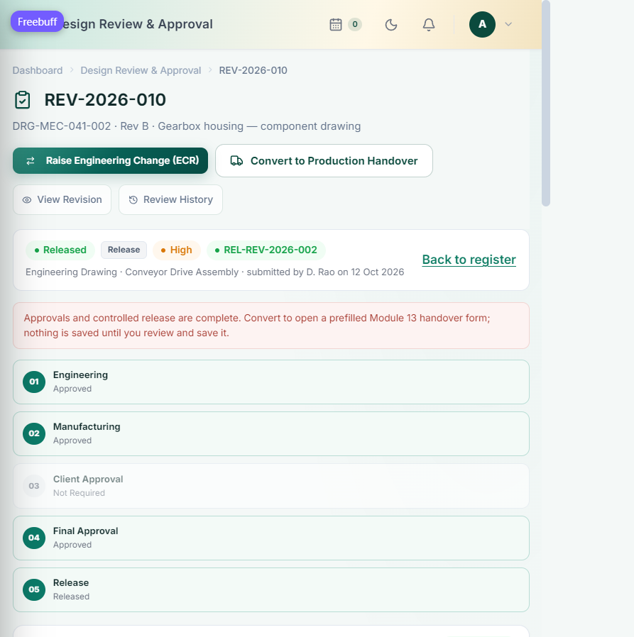
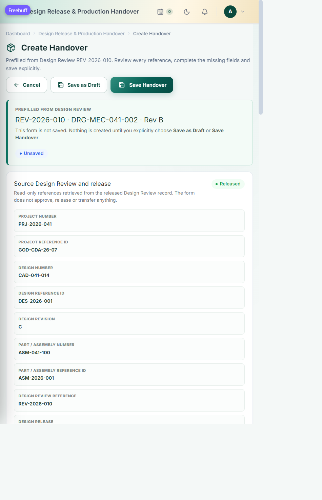
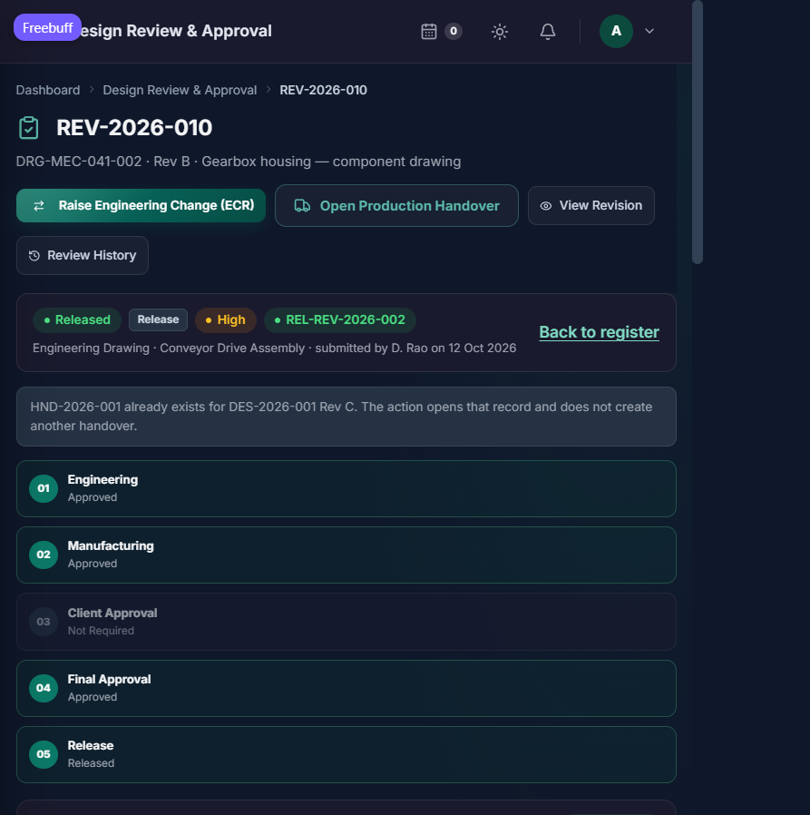
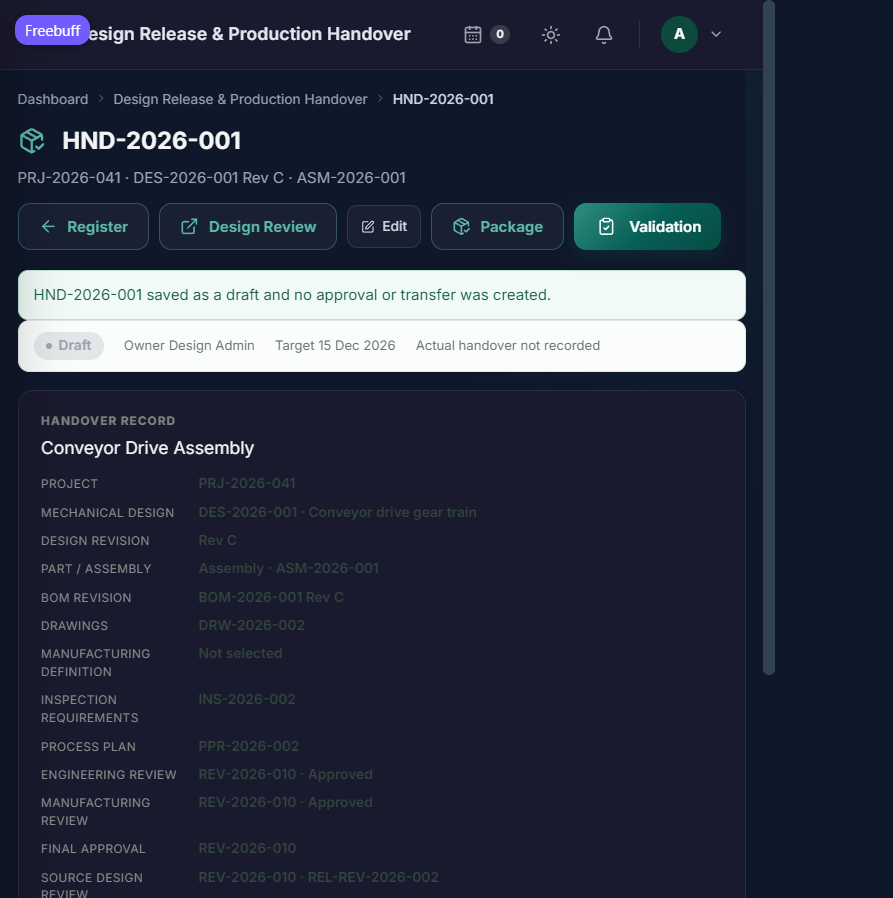

# Design Review & Approval → Module 13 Production Handover Integration

**Implementation and verification report**

- **Project:** `C:\Users\Mahes\Desktop\Design`
- **Source module:** Design Review & Approval (`/design-review`)
- **Destination:** Module 13 → Handover Register → Create Handover (`/design-handover/new`)
- **Date:** 17 November 2026
- **Build:** PASS — `npm run build`, exit code `0`



## 1. Summary

A **Convert to Production Handover** action now appears on the Design Review details page for a fully approved and released review. It opens the existing Module 13 Create Handover form with the project, exact design revision, part/assembly, BOM, drawing revision, related manufacturing records, review statuses and release reference prefilled from actual records.

No record is created by conversion, opening the form or editing fields. **Save as Draft** and the confirmed **Save Handover** are the only actions that persist a handover.

A duplicate check runs in three places:

1. Before conversion on the Design Review details page.
2. On direct navigation to the prefilled form.
3. Again inside the shared handover save function.

If a handover already exists for the project, design and revision, the existing handover is opened instead of creating a new one.

## 2. Existing functionality discovered

The review module uses `ApprovalsContext` (`md-approvals-state-v1`) and exposes:

- Review register, Engineering Review, Manufacturing Review, Client Approval and Release History.
- `review` records with `projectId`, `designId`, `designRevision`, deliverable revision, BOM and drawing IDs/revisions.
- `stageStates.engineering`, `stageStates.manufacturing` and `stageStates.client`.
- `finalApproval` and `release` (`releaseId`, release date, approved by, exact BOM/drawing revisions).
- Existing actions on the detail page: Raise Engineering Change (ECR), View Revision and Review History.
- Existing ECR records from `EngineeringReleaseContext`, including project, design, BOM, drawing and revision references.

The Module 13 create form already supported project, design, part/assembly, BOM, drawings, manufacturing definition, inspection, process plan, reviews, owner, target date and notes.

**No equivalent Production Handover action existed** in the Design Review details page. No existing button was duplicated.

## 3. Files created and modified

### Created

| File | Purpose |
|---|---|
| `src/data/designHandoverConversion.js` | Pure eligibility, applicable-ECR filtering and review-to-handover prefill helpers |
| `docs/design-review-to-handover-integration-report.md` | This report |
| `docs/design-review-handover-evidence/*.png` | Actual browser evidence captures |

### Modified

| File | Change |
|---|---|
| `src/pages/approvals/ReviewDetailPage.jsx` | Conversion button, eligibility banner, duplicate redirect and notice display |
| `src/context/DesignHandoverContext.jsx` | Added duplicate lookup by project + design + revision |
| `src/pages/design-handover/NewHandoverPage.jsx` | Prefill, read-only source summary, draft/final save, confirmation, cancel, duplicate guards and source references |
| `src/pages/design-handover/HandoverDetailPage.jsx` | Saved feedback, source review notice/reference and back-link to the Design Review |
| `src/styles/design-handover.css` | Prefill summary, status grid and read-only source styles |
| `src/styles/approvals.css` | Success banner on the review detail page |

No routing or navigation architecture was changed. The existing Module 13 five-tab structure is untouched.

## 4. Button location and eligibility

The action is in the Design Review details header actions, after **Raise Engineering Change (ECR)** and before **View Revision** / **Review History**.

It becomes **Convert to Production Handover** only when:

- Engineering Review is `Approved`.
- Manufacturing Review is `Approved` when the review requires that stage.
- Client Approval is `Approved` when client approval is required.
- Final Approval is completed.
- A controlled design release exists.
- The linked design still matches the reviewed design revision.
- No applicable unresolved ECR affects the revision.
- No handover already exists for the project + design + revision.

If an existing handover is found, the label becomes **Open Production Handover** and opens the existing details page.

When conversion is unavailable, the button is disabled and a banner lists every blocking reason. The disabled state does not approve, release, save or transfer anything.

### ECR applicability

An unresolved ECR is applicable when its project matches and at least one of these matches the review:

- Design ID
- BOM ID
- Drawing ID / impacted drawing ID
- Current or recorded design revision

ECRs with no matching reference are not treated as applicable. Final approval and release checks do not create change records.

## 5. Prefilled fields and actual sources

The form is resolved from the live review and linked contexts at open time.

| Form information | Actual source |
|---|---|
| Project and project ID | `ProjectsContext` / review `projectId` |
| Project number and reference ID | Project `id` and `reference` |
| Mechanical design and reference ID | `MechanicalContext` / review `designId` |
| Design number | Design `cadRef` |
| Design revision | Review `designRevision`, verified against the design record |
| Part / assembly | Review `partRef`, matched to an actual assembly or part; otherwise the design record |
| BOM and revision | Review `bomId` / `bomRevision`, only if the current BOM revision still matches |
| Drawing revisions | Review drawing ID/revision plus exact drawing references recorded on the review |
| Manufacturing definition | Unique project record matching the linked drawing revision or part/assembly |
| Inspection requirements | Same matching rule |
| Process plan | Same matching rule |
| Engineering review | Selected review record |
| Manufacturing review | Selected review record where applicable |
| Final approval | Selected review when a completed final approval exists |
| Review statuses | Live `stageStates` and `finalApproval` |
| Design release | Review `release.releaseId` |
| Notes | Factual note naming the source review and release |
| Handover owner | Current user default, editable — not invented from review data |
| Target handover date | Empty, required user entry — not guessed from a review due date |

On the actual released test review (`REV-2026-010`):

- Project `PRJ-2026-041`, reference `GOD-CDA-26-07`
- Design `DES-2026-001`, design number `CAD-041-014`, Rev C
- Assembly `ASM-2026-001` / `ASM-041-100`
- BOM `BOM-2026-001` Rev C
- Drawing `DRW-2026-002` / `DRG-MEC-041-002` Rev B
- Inspection `INS-2026-002`
- Process plan `PPR-2026-002`
- Engineering Review, Manufacturing Review and Final Approval: Approved
- Client Approval: Not Required
- Release `REL-REV-2026-002`

The manufacturing definition remained empty and visibly showed **Not Available — no single linked manufacturing definition was found** rather than selecting a guess. The owner and target date remained user-completable fields.

## 6. Source reference preservation

A saved converted handover contains both normal Module 13 fields and an explicit source snapshot:

- `sourceReviewId`
- `sourceReleaseId`
- `sourceReviewPath`
- `sourceRefs.projectId`
- `sourceRefs.designId`
- `sourceRefs.designRevision`
- `sourceRefs.itemId`
- `sourceRefs.bomId` and `sourceRefs.bomRevision`
- `sourceRefs.drawingIds`
- `sourceRefs.manufacturingId`
- `sourceRefs.inspectionId`
- `sourceRefs.processPlanId`
- Existing review IDs in `engineeringReviewId`, `manufacturingReviewId` and `finalApprovalId`

The source records are referenced, not copied or duplicated. The Handover Details page shows the source Design Review and release, and provides a **Design Review** action back to `/design-review/review/:reviewId`.

## 7. Manual save behaviour

- Conversion only navigates to `/design-handover/new?fromReview=REV-…` with router state `{ sourceReviewId, returnTo }`.
- No temporary or hidden handover is created for navigation.
- The form header marks the record **Unsaved** when prefilled.
- Opening the form writes nothing.
- Editing project-independent fields writes nothing.
- **Save as Draft** validates the form and persists a Draft immediately.
- **Save Handover** validates the form, opens a confirmation dialog, and persists only after **Confirm Save Handover**.
- **Keep editing** or the dialog close action leaves the form unsaved.
- Success is shown on the Handover Details page only after the record exists.
- Cancel returns to the source Design Review and writes nothing.
- The existing Module 13 workflow still creates a Draft handover; package preparation, validation and release remain separate steps.

## 8. Duplicate prevention

`findHandoverForRevision({ projectId, designId, designRevision })` checks the shared Module 13 store.

- Review detail: existing handover opens directly with an explanation.
- New form: direct or another navigation path redirects to the existing details page.
- Save: `saveHandover` repeats the duplicate check and returns an error naming the existing handover.

Tested cases:

- Existing `HND-2026-001` for `DES-2026-001` Rev C caused **Open Production Handover** instead of conversion.
- Direct `/design-handover/new?fromReview=REV-2026-010` redirected to the existing handover with a notice.
- Manual save for the same project/design/revision returned: “HND-2026-001 already covers DES-2026-001 Rev C. Open the existing handover instead of creating a duplicate.”
- No additional record was added by any duplicate path.

## 9. Navigation flow

```text
Design Review Register
→ Design Review Details
→ Verify approvals and controlled release
→ Convert to Production Handover
→ /design-handover/new?fromReview=REV-…
→ Prefilled Create Handover form (unsaved)
→ Review / complete owner and target date
→ Save as Draft OR Save Handover → confirmation
→ Handover Details
→ Design Review action returns to the source review
```

Cancel returns to `/design-review/review/:reviewId` for a converted form, or to the normal handover register/details path for a manual create/edit.

## 10. Actual test results

### Test environment note

The existing Module 13 store already contained `HND-2026-001` and `HND-2026-002`, so a released review could not be saved again without a duplicate. To test the successful prefill/save path without deleting or overwriting those records, the browser-local Module 13 store was snapshotted, isolated, exercised, and then restored exactly.

After restore the store again contains:

- Handovers: `HND-2026-002`, `HND-2026-001`
- Package: `PKG-2026-001`
- Release: `DRL-2026-001`
- Transfers: `XFR-2026-003`, `XFR-2026-002`, `XFR-2026-001`

No source project, design, BOM, drawing, manufacturing, review or approval record was changed. The saved-details screenshot therefore shows the isolated test handover, not a replacement of the retained production record.

### Test matrix

| # | Test | Result | Evidence |
|---|---|---|---|
| 1 | Convert button appears in details header | **PASS** | `review-detail-conversion-button.png` |
| 2 | Approved and released design enables conversion | **PASS** | `REV-2026-010`, enabled button |
| 3 | Pending Engineering Review blocks conversion | **PASS** | `REV-2026-012`, disabled with reason |
| 4 | Pending/Changes Requested Manufacturing Review blocks where applicable | **PASS** | `REV-2026-005`, disabled; helper check for `Pending` |
| 5 | Pending Final Approval blocks conversion | **PASS (helper)** | No seeded review in this exact state; eligibility helper returned “Final Approval is not completed.” |
| 6 | Unreleased design blocks conversion | **PASS** | `REV-2026-007`, disabled with “not been released” |
| 7 | ECR not applicable does not block | **PASS** | `REV-2026-010` convertible with resolved project ECRs |
| 8 | Applicable unresolved ECR blocks | **PASS** | `REV-2026-008`, ECR-2026-002 |
| 9 | Convert opens the Module 13 create form | **PASS** | `/design-handover/new?fromReview=REV-2026-010` |
| 10 | Project information prefilled | **PASS** | Project `PRJ-2026-041`, reference `GOD-CDA-26-07` |
| 11 | Design and revision prefilled | **PASS** | `DES-2026-001` Rev C, design number `CAD-041-014` |
| 12 | BOM and drawing references prefilled | **PASS** | BOM `BOM-2026-001` Rev C; drawing `DRG-MEC-041-002` Rev B |
| 13 | Approval and release information prefilled | **PASS** | Engineering/Manufacturing/Final Approved; client Not Required; `REL-REV-2026-002` |
| 14 | Missing information remains empty, not fabricated | **PASS** | Manufacturing definition empty and marked Not Available; target date empty |
| 15 | Editing handover-specific fields works | **PASS** | Owner and target date editable; target set to 15/18 Dec 2026 during tests |
| 16 | Opening the form creates no record | **PASS** | Handover count `0` after open and after field edit |
| 17 | Cancel creates no record | **PASS** | Returned to review; count remained `0` |
| 18 | Save as Draft creates only after explicit action | **PASS** | Count became `1`; success message: saved as a draft |
| 19 | Save Handover creates only after confirmation | **PASS** | Confirmation modal; Keep editing left count `0`; Confirm created the record |
| 20 | Duplicate detection works | **PASS** | Details label, direct URL redirect and save-time error |
| 21 | Refresh persistence works | **PASS** | Source review, release, refs and drawing IDs survived reload |
| 22 | Navigation back to Design Review works | **PASS** | Handover Details → Design Review returned to `REV-2026-010` |

No final test failed.

### Screenshots

All captures are actual browser screenshots in `docs/design-review-handover-evidence/`:

| File | Shows |
|---|---|
| `review-detail-conversion-button.png` | Enabled conversion button and eligibility message |
| `prefilled-create-form.png` | Unsaved prefilled form with source review facts |
| `form-before-save.png` | Read-only source fields and handover-specific fields before saving |
| `final-save-confirmation.png` | Confirmation before final save |
| `saved-handover-details.png` | Saved draft, source review reference and success feedback |
| `duplicate-detection.png` | Existing handover action and explanation |
| `review-blocked.png` | Disabled conversion with approval, release and ECR reasons |





## 11. Build result

```text
npm run build
✓ transformed
✓ built
BUILD_EXIT=0
```

The pre-existing `occt-import-js` externalisation and large bundle warnings remain. No new build error was introduced.

## 12. Limitations

- Conversion does not release, approve, save or transfer anything.
- No direct ERP Production import was added; this integration stops at the Module 13 handover record.
- The owner and target handover date are not present on Design Review records; the owner defaults to the current user and the target date must be entered. They are never guessed.
- Manufacturing definition remained unselected for the test review because no single record could be linked unambiguously by drawing revision. The form states that it is Not Available and lets the user select an existing record.
- A seeded review in the exact “all mandatory stages approved, final approval pending” state did not exist; that condition was verified with the pure eligibility helper rather than a browser record.
- The successful-save test used an isolated snapshot of the Module 13 store and restored the original store afterwards. Current retained handovers `HND-2026-001` and `HND-2026-002` were created before this integration and therefore do not contain `sourceReviewId`.
- The health of external ERP Production behaviour remains outside this integration.
