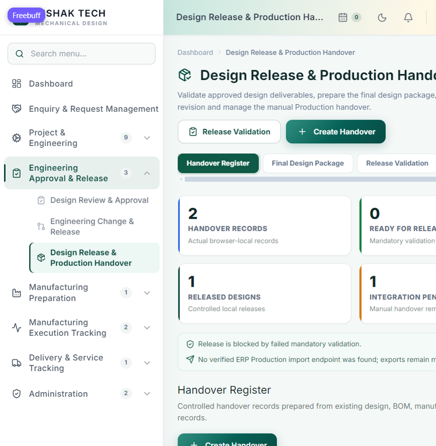
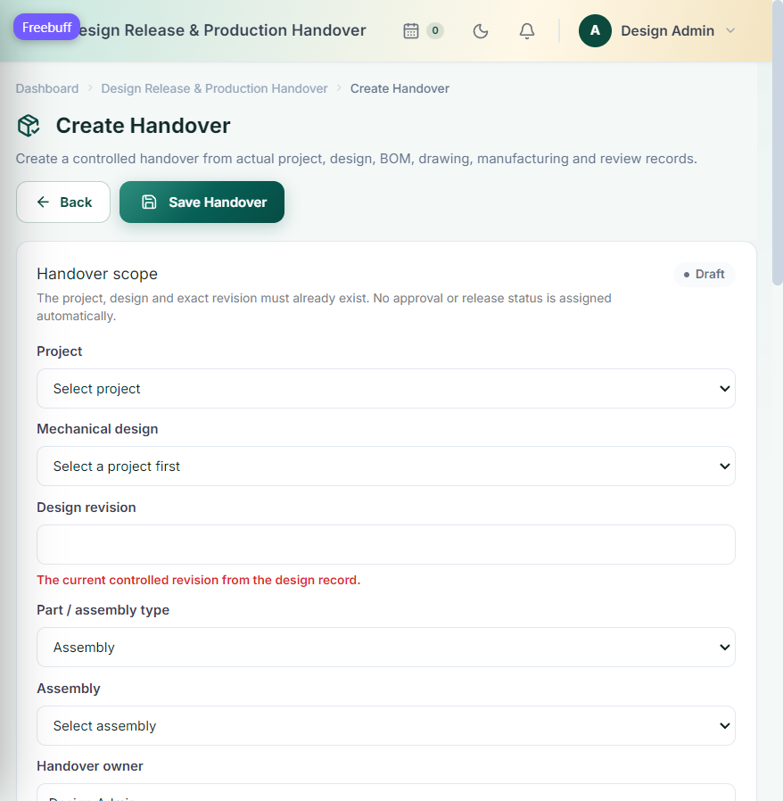
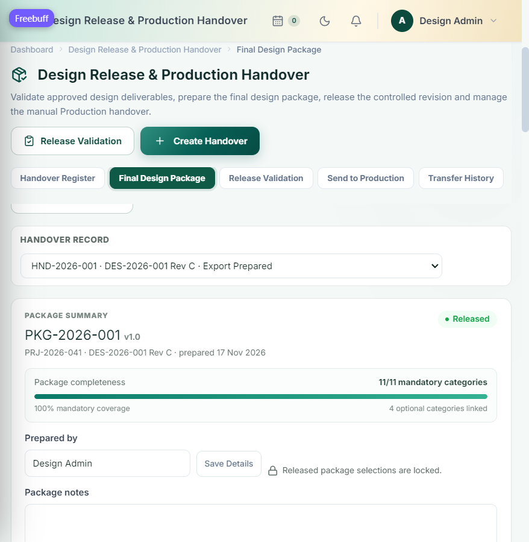
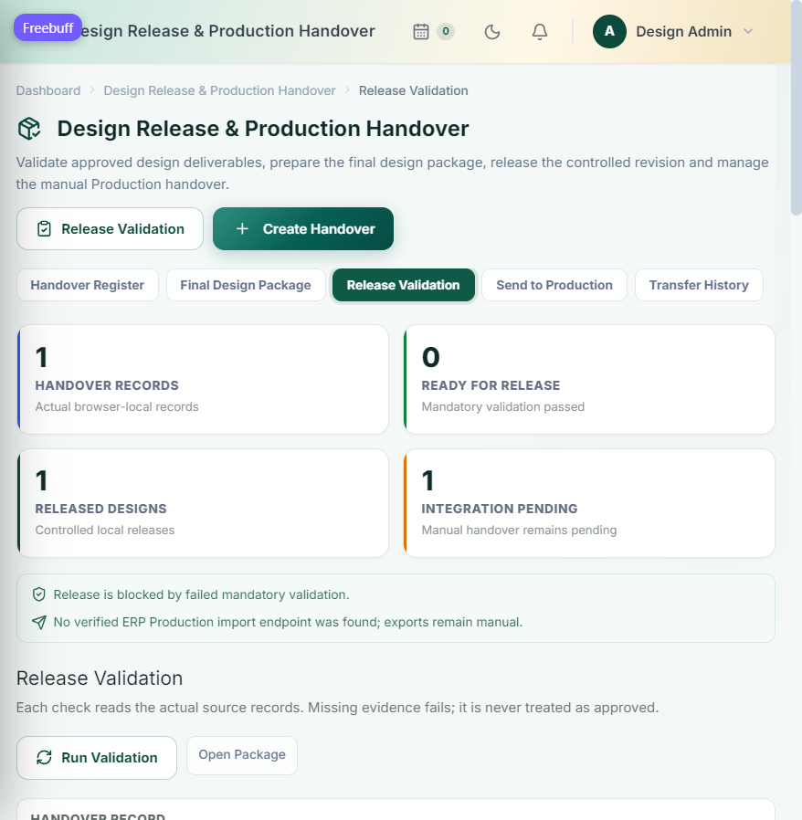
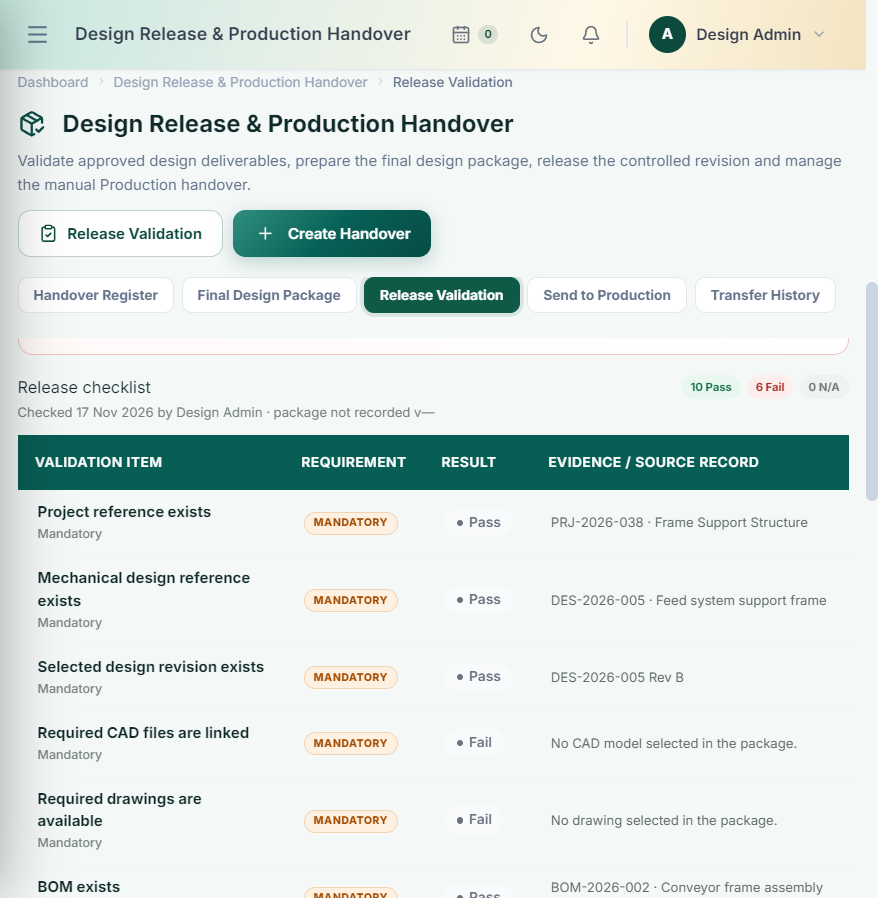
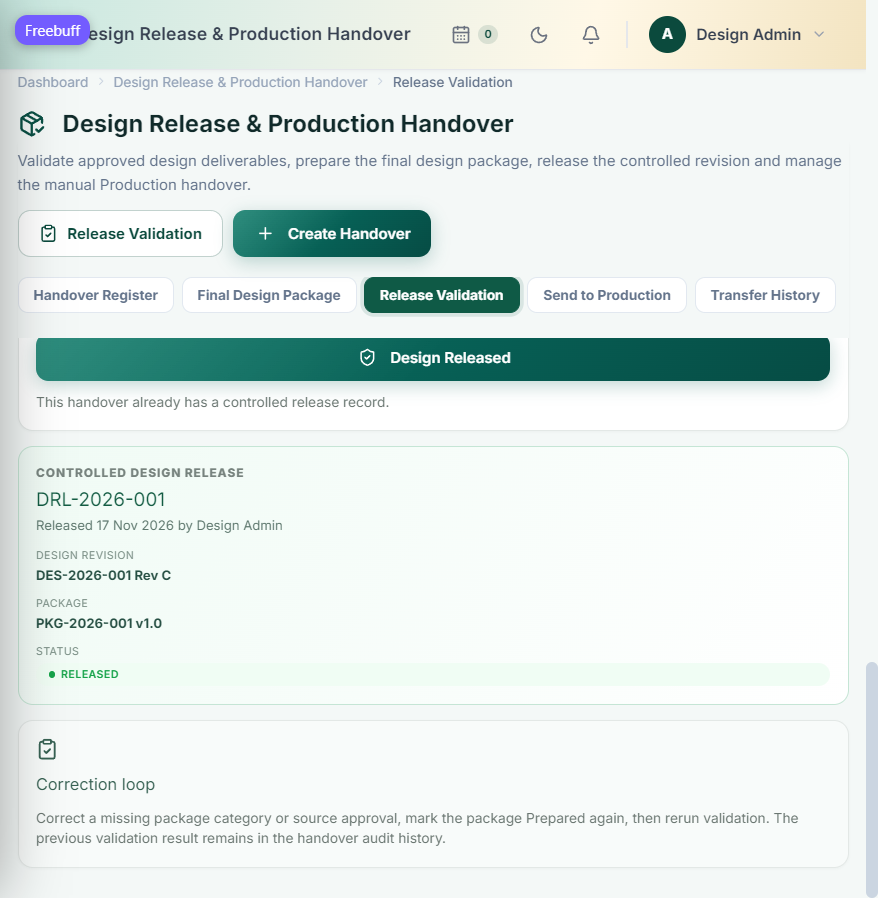
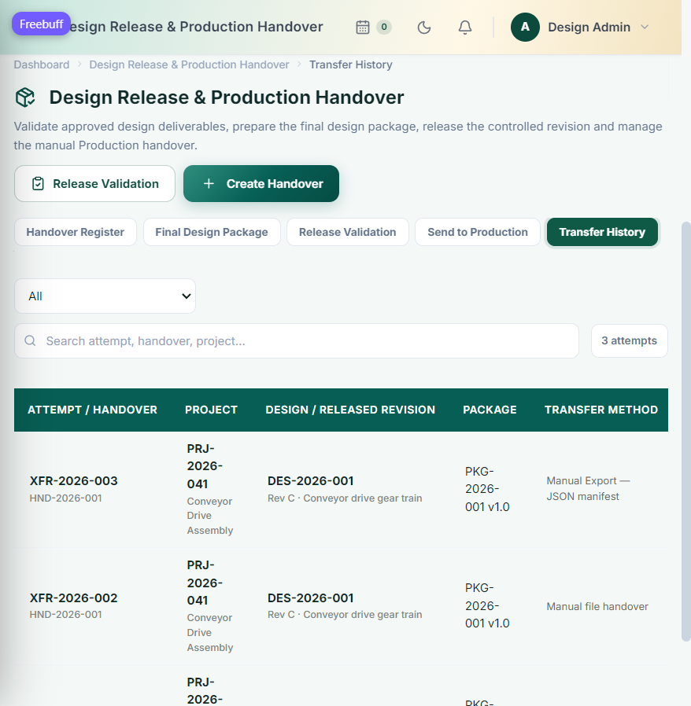
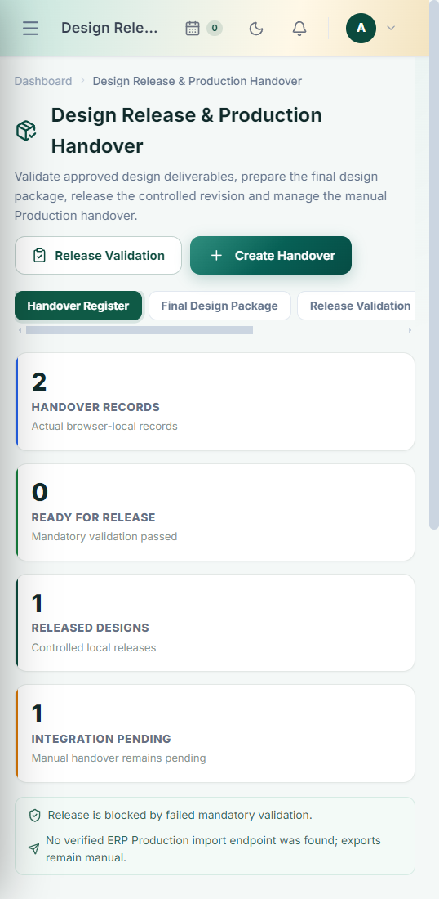

# Module 13 — Design Release & Production Handover

**Implementation and verification report**

- **Project:** `C:\Users\Mahes\Desktop\Design`
- **Module:** Design Release & Production Handover
- **Base route:** `/design-handover`
- **Report date:** 17 November 2026
- **Build:** PASS — `npm run build`, exit code `0`
- **Direct ERP Production transfer:** NOT TESTED / UNAVAILABLE — no design-package import endpoint was found in the inspected ERP

## 1. Summary

Module 13 is a new frontend-only module in the existing design ERP shell. It adds one sidebar entry, **Design Release & Production Handover**, with exactly five tabs:

1. Handover Register
2. Final Design Package
3. Release Validation
4. Send to Production
5. Transfer History

It links handover, package, validation, release and transfer records to **existing** project, mechanical-design, CAD, drawing, BOM, manufacturing, simulation, analysis, review and engineering-change data. It does not create source documents, approvals, ERP references or transfer acknowledgements.

Release is blocked when any mandatory validation check fails. A controlled local release is recorded only after a passing validation and explicit confirmation.

The inspected ERP Production area has work-order, drawing and model functionality, but **no design-package import or handover endpoint**. Direct transfer therefore remains **Integration Pending**. Manual export is recorded as **Ready for Export** or **Integration Pending**, never as a verified ERP transfer.



## 2. Scope and constraints honoured

- Work was limited to `C:\Users\Mahes\Desktop\Design`.
- The existing ERP at `C:\Users\Mahes\Desktop\ERP` was inspected read-only.
- No backend, database, API, authentication or integration service was added.
- Existing localStorage keys and records were not reset or overwritten.
- The hidden legacy `/transfers*` routes and `TransfersContext` were left intact; Module 13 uses a separate route tree and storage key.
- No source fixture documents, approvals, destination references, ERP success messages or transfer dates were invented.
- Failed, pending and successful manual attempts are retained. A retry creates a new attempt without modifying the old one.

## 3. Navigation and routes

`src/config/navigation.js` now exposes one Module 13 entry in **Engineering Approval & Release**. Tabs:

| Tab | Route | Purpose |
|---|---|---|
| Handover Register | `/design-handover` | Search, filter and open records |
| Final Design Package | `/design-handover/package` | Link actual source records and mark Prepared |
| Release Validation | `/design-handover/validation` | Run 16 checks and gate release |
| Send to Production | `/design-handover/send` | Download manifest and record manual attempts |
| Transfer History | `/design-handover/history` | Permanent transfer audit and retry |

Additional routes: `/design-handover/new`, `/design-handover/:handoverId` and `/design-handover/:handoverId/edit`. `src/App.jsx` mounts `DesignHandoverProvider` inside `EngineeringReleaseProvider` and registers the routes.

## 4. Files

### Added

| File | Responsibility |
|---|---|
| `src/data/designHandoverData.js` | Categories, statuses, completeness, 16 validation rules, manifest builder |
| `src/context/DesignHandoverContext.jsx` | Persistence, CRUD, source linking, validation, release gate, export and retry |
| `src/pages/design-handover/DesignHandoverModulePage.jsx` | Module shell, five-tab switch and statistics |
| `src/pages/design-handover/HandoverRegisterTab.jsx` | Register, filters and draft actions |
| `src/pages/design-handover/NewHandoverPage.jsx` | Full-page create/edit form with actual selectors |
| `src/pages/design-handover/HandoverDetailPage.jsx` | Record, package, validation, release and attempts |
| `src/pages/design-handover/FinalDesignPackageTab.jsx` | Package creation, source linking, Prepared state |
| `src/pages/design-handover/ReleaseValidationTab.jsx` | Check table, blocking summary and release confirmation |
| `src/pages/design-handover/SendToProductionTab.jsx` | Manifest export and manual attempt recording |
| `src/pages/design-handover/TransferHistoryTab.jsx` | Permanent audit and retry |
| `src/pages/design-handover/designHandoverUi.jsx` | Shared selector, stat, completeness and summary UI |
| `src/styles/design-handover.css` | Scoped desktop and responsive styles |

### Modified

| File | Change |
|---|---|
| `src/config/navigation.js` | Replaced the visible legacy transfer entry with Module 13 and five tabs |
| `src/App.jsx` | Added provider, imports and `/design-handover*` routes |

## 5. Persistence and data integrity

Storage key: `md-design-handover-state-v1`. Persisted collections: `handovers`, `packages`, `releases`, `transfers`.

Rules implemented:

- Sequential references: `HND-2026-###`, `PKG-2026-###`, `DRL-2026-###`, `XFR-2026-###`.
- A handover stores the exact controlled design revision; if the design revision changed, saving is blocked.
- A duplicate project + design + revision handover is rejected and the existing record is named.
- Only a `Draft` handover can be deleted.
- A released or exported handover cannot be edited.
- Released package selections are locked.
- Every meaningful action appends an audit entry; history is never rewritten.
- Validation and release re-evaluate current source records; a stale saved pass cannot force release.
- Package items are copied from the live catalog only after confirming the source still exists.
- Failed downloads remain as `Export Failed`; retry adds a new attempt.

## 6. Actual source integrations

| # | Category | Source module | Mandatory |
|---|---|---|---|
| 1 | Approved Mechanical Design | Mechanical Engineering Design | Yes |
| 2 | Released Design Revision | Mechanical Engineering Design | Yes |
| 3 | Final CAD Models | Drawing & CAD Management | Yes |
| 4 | Engineering Drawings | Drawing & CAD Management | Yes |
| 5 | BOM and BOM Revision | BOM & Cost Estimation | Yes |
| 6 | Material Specifications | BOM item material references | No |
| 7 | Manufacturing Definitions | Manufacturing Design | Yes |
| 8 | Inspection and Quality Requirements | Manufacturing Design | Yes |
| 9 | Process Plans and Work Instructions | Manufacturing Design | Yes |
| 10 | Simulation and Validation Reports | Simulation & Design Validation | No |
| 11 | Engineering Analysis Reports | Engineering Analysis | No |
| 12 | Engineering Review Records | Design Review & Approval | Yes |
| 13 | Manufacturing Review Records | Design Review & Approval | Yes |
| 14 | Approval Evidence | Design Review & Approval | Yes |
| 15 | Approved Engineering Change Records | Engineering Change & Release | No |

Result: **11 mandatory**, 4 optional categories. CAD sources exclude superseded files and are limited to current model formats. All category lists are filtered to the selected project. No source fixture was added.

## 7. ERP Production inspection finding

The ERP Production area was inspected without modification: `/production` screens, frontend contexts/service calls, and backend Production controllers/routes. The inspected area exposes production work orders, drawings and models. **No design-package import, handover receipt or acknowledgement endpoint was found.**

Consequences:

- Direct transfer is not presented as available.
- No destination reference, transfer date or success status is generated.
- Manifest export remains manual.
- A download is recorded as **Ready for Export**, not transferred.
- A manual file handover remains **Integration Pending** until a real acknowledgement is entered.
- The UI states that no verified Production import endpoint exists.

## 8. Release validation

Sixteen checks are evaluated from live records:

1. Project reference exists
2. Mechanical design reference exists
3. Selected design revision exists
4. Required CAD files are linked
5. Required drawings are available
6. BOM exists
7. BOM revision is selected
8. Manufacturing definition is available
9. Inspection requirements are available where applicable
10. Process plan is available where applicable
11. Engineering review is approved
12. Manufacturing review is approved
13. Final design approval is completed
14. Required engineering changes are closed or resolved
15. No unresolved mandatory revision issue remains
16. Final design package is prepared

Inspection and process-plan checks return `Not Applicable` only when no such record exists for the project; if a record exists but is not selected, the check fails.

`releaseDesign` requires explicit confirmation, a `Prepared` package, no mandatory failures recalculated at release time, and no prior release. The release record stores reference, date, released-by user, package version, revision and source references.

## 9. Transfer semantics and audit

| Action | Recorded status | Claim made |
|---|---|---|
| Download JSON manifest | `Ready for Export` | File generated locally; no Production acknowledgement |
| Record manual file handover or secure share | `Integration Pending` | Handover attempted; acknowledgement not received |
| Browser download failure | `Export Failed` | Failure retained; no success claimed |
| Retry | New `XFR-...` row | Previous attempt is not modified |

The manifest includes the format/version, generation date and user, `integration.verifiedIntegration: false`, `transferStatus: "Integration Pending"`, project, design and exact revision, item, owner, package version/status, all 15 categories with actual selected source references, release reference/date when present, and manual handover instructions.

The destination-reference field remains blank unless the user enters a real reference. The form states that the application does not generate an ERP reference.

## 10. Verified workflows and retained test records

| Record | Purpose | Final state |
|---|---|---|
| `HND-2026-001` | Successful path for `PRJ-2026-041` / `DES-2026-001` Rev C / `ASM-2026-001` | `Export Prepared`; release `DRL-2026-001` recorded |
| `PKG-2026-001` v1.0 | 47 actual source links, 11/11 mandatory categories | `Released` |
| `HND-2026-002` | Retained validation-failure evidence for `PRJ-2026-038` without a package | `Validation Failed` |

`HND-2026-003` was created during testing to verify draft edit and delete. Its notes were updated, the audit recorded “Handover draft updated”, and it was then deleted.

No existing source record was modified.

### Successful validation — `HND-2026-001`

- 16 total checks; 16 Pass; 0 Fail; 0 Not Applicable; 0 Pending
- Status `Ready for Release`
- Release `DRL-2026-001`, `DES-2026-001` Rev C, `PKG-2026-001` v1.0, 17 Nov 2026, Design Admin

Earlier in this test both drawing links were removed; validation produced two mandatory failures and blocked release. The drawings were restored, the package was marked Prepared, and validation then passed.

### Failure validation — `HND-2026-002`

- 10 Pass; 6 Fail
- Failures included missing CAD, drawings, inspection plan, process plan, prepared package and an unresolved engineering change
- Release button disabled; status `Validation Failed`

### Retained transfer attempts

| Attempt | Method | Status | Actual export date | Actual transfer date | Destination |
|---|---|---|---|---|---|
| `XFR-2026-001` | Manual Export — JSON manifest | `Ready for Export` | 17 Nov 2026 | Not verified | — |
| `XFR-2026-002` | Manual file handover | `Integration Pending` | — | Not verified | — |
| `XFR-2026-003` | Manual Export — JSON manifest (retry of 002) | `Ready for Export` | 17 Nov 2026 | Not verified | — |

Retry message: “XFR-2026-003 added. The previous attempt XFR-2026-002 remains unchanged in the audit history.”

## 11. Test matrix

| Test | Result | Evidence |
|---|---|---|
| Production build | **PASS** | `npm run build`, exit `0` |
| One sidebar entry and five tabs | **PASS** | Navigation and browser inspection |
| Create handover from actual records | **PASS** | `HND-2026-001`, `HND-2026-002` |
| Duplicate handover rejection | **PASS** | Existing handover named; record count unchanged |
| Edit draft | **PASS** | Notes and “Handover draft updated” audit entry |
| Delete draft | **PASS** | `HND-2026-003` removed |
| Link 47 actual source records | **PASS** | 11/11 mandatory categories |
| Validation pass | **PASS** | 16/16, `Ready for Release` |
| Validation failure blocks release | **PASS** | 10/16; release disabled |
| Controlled release | **PASS** | `DRL-2026-001` |
| Manifest download | **PASS** | Browser download initiated; `XFR-2026-001` recorded |
| Manual handover attempt | **PASS** | `XFR-2026-002`, `Integration Pending` |
| Retry preserves history | **PASS** | `XFR-2026-003`; prior attempts unchanged |
| Refresh persistence | **PASS** | 2 handovers, 1 release, 3 attempts after reload |
| Responsive layout at 430 × 880 | **PASS (layout)** | No body-level horizontal overflow; tab strip and tables scroll horizontally |
| Direct ERP Production transfer | **NOT TESTED / UNAVAILABLE** | No import endpoint exists in the inspected ERP |
| Production acknowledgement or real destination reference | **NOT TESTED** | None received; none invented |
| Downloaded JSON re-opened outside browser | **NOT TESTED** | Download was triggered; saved file was not re-opened |
| Release confirmation modal screenshot | **NOT CAPTURED** | Modal was exercised; resulting release record is captured |

No final test failed.

## 12. Fixes made during verification

1. **Released counter** — counted only the transient `Released` status, which becomes `Export Prepared` after a manual export. It now counts handovers with an actual release record.
2. **Stale validation feedback** — changing the selected handover could leave the previous result message visible. Feedback is cleared when the selector changes in Package, Validation and Send.
3. **Validation remarks** — passed inspection/process rows no longer display a “Select…” corrective remark.

## 13. Build verification

`npm run build`:

```text
✓ 2380 modules transformed.
✓ built in 1.50s
BUILD_EXIT=0
```

Pre-existing warnings remain: `occt-import-js` externalises Node `path`/`crypto`, and the main chunk exceeds 500 kB. Neither was introduced by Module 13.

## 14. Screenshot evidence

Actual captures in `docs/module-13-evidence/`:

| File | Shows |
|---|---|
| `handover-register.png` | Module entry, five tabs, register summary |
| `create-handover-form.png` | Create form using actual records |
| `duplicate-prevention.png` | Duplicate rejection |
| `handover-details.png` | Details, revision, links, audit |
| `final-design-package.png` | Package summary and completeness |
| `package-document-linking.png` | Category/source selector |
| `release-validation-pass.png` | Passing checks |
| `release-validation-failed.png` | Failing checks for `HND-2026-002` |
| `release-blocked-summary.png` | Blocking summary |
| `release-readiness-released.png` | Released readiness |
| `controlled-release-record.png` | `DRL-2026-001` |
| `send-to-production.png` | Integration finding and export |
| `manual-handover-recording.png` | Manual attempt form/table |
| `transfer-history.png` | Permanent history |
| `transfer-history-status.png` | Status and date columns |
| `responsive-register-top.png` | 430 px responsive register |









## 15. Limitations and open items

- **No ERP integration:** a Production acknowledgement API is required before direct transfer or verified dates can be shown; export remains manual by design.
- **Browser-local records:** all Module 13 records use localStorage, consistent with the existing frontend-only application.
- **Test state retained:** `HND-2026-001`, `HND-2026-002`, `PKG-2026-001`, `DRL-2026-001` and `XFR-2026-001..003` remain as verification evidence and are visible in the UI.
- **Downloaded file:** the JSON download was triggered and recorded, but the saved file was not opened or schema-validated outside the browser.
- **Responsive scope:** the register and tab strip were checked at 430 px; every tab was not separately screenshotted at that width.
- **Confirmation modal:** exercised, but its image was not captured.
- The legacy hidden transfer module still exists at `/transfers*`; it is no longer the visible sidebar entry.

## 16. Review steps

1. Start the existing design application and open `/design-handover`.
2. Open `HND-2026-001` to see Rev C, 47 linked sources and `DRL-2026-001`.
3. Open **Release Validation** for `HND-2026-001`: 16 Pass; further release is blocked because a release exists.
4. Open **Transfer History**: `XFR-2026-001..003` remain visible; no verified transfer date or destination is claimed.
5. Select `HND-2026-002` in **Release Validation** to see the retained 6-failure blocking result.
6. Confirm **Send to Production** displays the ERP integration finding and manual-export status.
